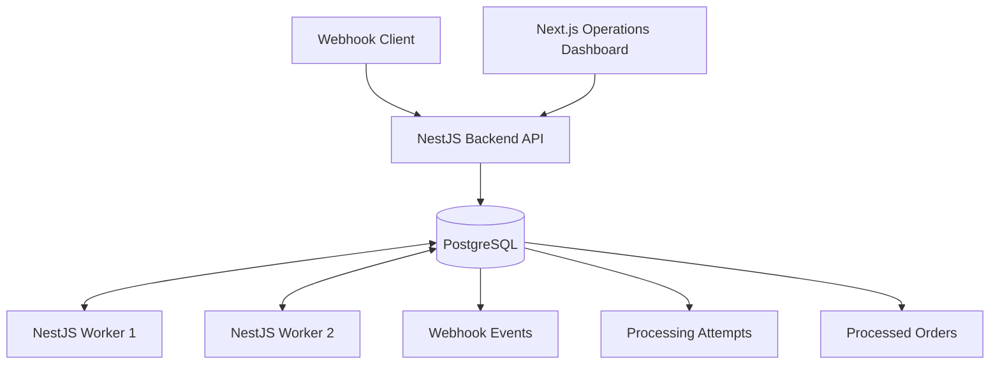
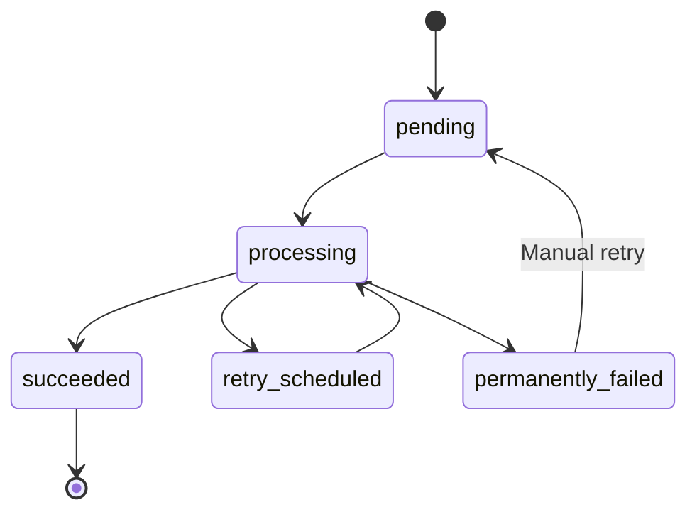

# Reliable Webhook Processor

A reliable, asynchronous webhook processing system built for the Surpluss Full Stack Software Engineer assessment.

The system accepts webhook events, persists them before acknowledgement, processes them through independent background workers, handles duplicate deliveries, retries failures, recovers interrupted processing, and provides an operations dashboard.

## 1. Features

### Core Features

- Persistent webhook ingestion with HTTP 202 acknowledgement.
- Concurrent duplicate delivery protection.
- First-payload-wins semantics.
- PostgreSQL-backed persistent job queue.
- Two independent background worker containers.
- Concurrent processing of independent events.
- Configurable retry limits and exponential backoff.
- Permanent failure handling.
- Automatic crash recovery.
- Exactly-once database business effects per event.

### Additional Features

- Complete processing attempt history.
- Worker identification and execution timestamps.
- Manual retry with a fresh retry budget.
- Continuous lifetime attempt numbering.
- Next.js operations dashboard.
- Automated integration tests.
- Reusable demonstration and burst-testing scripts.

## 2. Technology Stack

| Technology         | Purpose                                           |
| ------------------ | ------------------------------------------------- |
| TypeScript         | Type-safe application development                 |
| NestJS             | Backend API and standalone worker applications    |
| Next.js            | Operations dashboard                              |
| PostgreSQL         | Persistent storage, queue and concurrency control |
| node-postgres (pg) | Parameterized SQL and connection pooling          |
| node-pg-migrate    | Version-controlled database migrations            |
| Tailwind CSS       | Dashboard styling                                 |
| Jest and Supertest | Automated integration testing                     |
| Docker Compose     | Multi-container orchestration                     |

PostgreSQL was selected as both the database and queue to avoid introducing an additional infrastructure dependency such as Redis.

Raw SQL provides explicit control over transactions, row locking, advisory locking and retry scheduling.

## 3. Architecture



The backend is responsible for accepting events and exposing operational APIs.

The workers are independent NestJS standalone applications responsible for claiming, processing, retrying and recovering events.

The frontend communicates with the backend through Next.js API rewrites.

All durable processing state is stored in PostgreSQL.

## 4. Project Structure

```text
surpluss-webhook-processor/
├── backend/
│   ├── src/
│   │   ├── database/
│   │   └── webhooks/
│   ├── test/
│   └── Dockerfile
├── worker/
│   ├── src/
│   │   ├── database/
│   │   └── processing/
│   ├── test/
│   └── Dockerfile
├── frontend/
│   ├── src/app/
│   └── Dockerfile
├── migrations/
├── scripts/
│   ├── demo.mts
│   └── burst-test.mts
├── docker-compose.yml
├── package.json
└── README.md
```

## 5. Getting Started

### Prerequisites

- Docker
- Docker Compose v2
- Node.js 24 or later for local scripts and tests
- npm

### Start the Application

From the project root:

```bash
docker compose up --build -d
```

Docker Compose starts PostgreSQL, applies database migrations, starts the backend, starts two independent workers and launches the frontend.

Verify the services:

```bash
docker compose ps
```

| Service              | Address                      |
| -------------------- | ---------------------------- |
| Operations Dashboard | http://localhost:3000        |
| Backend API          | http://localhost:3001        |
| Health Check         | http://localhost:3001/health |
| PostgreSQL           | localhost:5432               |

The migration container is expected to exit successfully after applying migrations.

View worker logs:

```bash
docker compose logs -f worker-1 worker-2
```

Stop the application:

```bash
docker compose down
```

PostgreSQL data is preserved in a Docker volume.

To intentionally remove all persisted data:

```bash
docker compose down -v
```

Warning: Removing the volume permanently deletes stored events, attempt history and processed orders.

## 6. API Endpoints

| Method | Endpoint                    | Description                      |
| ------ | --------------------------- | -------------------------------- |
| GET    | /health                     | Backend liveness check           |
| POST   | /webhooks                   | Accept a webhook event           |
| GET    | /webhooks                   | List webhook events              |
| GET    | /webhooks/:eventId          | Retrieve event details           |
| GET    | /webhooks/:eventId/attempts | Retrieve attempt history         |
| POST   | /webhooks/:eventId/retry    | Retry a permanently failed event |

### Submit a Webhook

```bash
curl -X POST http://localhost:3001/webhooks \
  -H "Content-Type: application/json" \
  -d '{
    "eventId": "evt_123",
    "type": "order.created",
    "data": {
      "orderId": "ORD-1001",
      "customerId": "CUS-42",
      "simulate": "fail_then_succeed:2"
    }
  }'
```

Response: HTTP 202 Accepted

```json
{
  "eventId": "evt_123",
  "accepted": true
}
```

HTTP 202 indicates durable acceptance, not successful completion of background processing.

Duplicate deliveries also return HTTP 202.

## 7. Event Lifecycle



An interrupted processing attempt transitions to either retry_scheduled or permanently_failed, depending on the remaining retry budget.

## 8. Database Design

### webhook_events

Stores the original webhook payload, current status, lifetime attempt count, current retry-cycle attempt count, retry schedule, worker ownership and latest error.

A unique constraint on event_id prevents duplicate event records.

### processing_attempts

Stores the history of every claimed processing attempt, including:

- Attempt number
- Worker identifier
- Start and finish timestamps
- Result
- Error details

The combination of webhook_event_id and attempt_number is unique.

### processed_orders

Represents the actual database business action.

Each event_id is unique, ensuring that an event cannot create multiple processed order records.

Database migrations include constraints, indexes and native PostgreSQL column documentation.

## 9. Correctness Guarantees

### Durable Acceptance

The backend awaits the PostgreSQL insert before returning HTTP 202. Accepted events remain persisted even if the backend or workers restart.

### Duplicate Protection

The event_id unique constraint and INSERT ON CONFLICT DO NOTHING protect against concurrent duplicate deliveries.

The first successfully inserted payload is preserved. Subsequent deliveries do not overwrite it.

### Concurrent Worker Safety

Workers use SELECT FOR UPDATE SKIP LOCKED to claim eligible events without blocking other workers unnecessarily.

Each claimed event is additionally protected by a PostgreSQL session-level advisory lock held on a dedicated database connection.

The advisory lock remains held throughout processing, including long-running simulations.

### Atomic Business Processing

The processed order insertion, successful event status update and successful attempt update execute within one PostgreSQL transaction.

Either all changes commit or all changes roll back.

The processed_orders unique constraint provides additional protection against duplicate business effects.

This guarantees exactly-once committed database effects per event, not exactly-once execution of arbitrary external side effects.

### Crash Recovery

If a worker crashes, PostgreSQL releases its session-level advisory locks when the connection terminates.

Other workers periodically inspect events in the processing state and attempt to acquire their advisory locks.

If the lock is unavailable, the event is still owned and is not recovered.

If the lock is available, the abandoned attempt is recorded as interrupted and the event is rescheduled or permanently failed according to its retry budget.

Recovery does not depend on a fixed processing lease, avoiding premature recovery of healthy long-running tasks.

### Retry Safety

Retries are persisted in PostgreSQL using next_attempt_at.

Workers only claim events whose scheduled execution time has arrived.

Manual retry resets the current retry-cycle counter without resetting lifetime attempt numbering or deleting previous attempts.

## 10. Retry Configuration

| Environment Variable    | Default |
| ----------------------- | ------- |
| MAX_ATTEMPTS            | 5       |
| RETRY_BASE_DELAY_MS     | 2000    |
| RETRY_MAX_DELAY_MS      | 60000   |
| WORKER_POLL_INTERVAL_MS | 500     |

Default retry delays:

| Failed Attempt | Next Retry Delay   |
| -------------- | ------------------ |
| 1              | 2 seconds          |
| 2              | 4 seconds          |
| 3              | 8 seconds          |
| 4              | 16 seconds         |
| 5              | Permanently failed |

Interrupted attempts also consume the retry budget.

All worker instances should use consistent retry configuration.

## 11. Simulation Modes

| Mode                | Behaviour                           |
| ------------------- | ----------------------------------- |
| ok                  | Successful processing               |
| fail_then_succeed:N | Fails the first N lifetime attempts |
| always_fail         | Fails every attempt                 |
| slow:N              | Waits N seconds before succeeding   |

If simulate is omitted, processing defaults to ok.

Long-running simulations retain their advisory locks throughout execution.

A fail_then_succeed value greater than the available retry budget results in permanent failure until manually retried.

## 12. Operations Dashboard

Available at http://localhost:3000.

The dashboard provides:

- Event status summaries
- Event search and status filtering
- Original event payload
- Lifetime and current-cycle attempt counts
- Processing attempt history
- Worker identification
- Error details
- Manual retry for permanently failed events
- Automatic refresh

## 13. Demonstration

With the Docker services running:

```bash
npm run demo
```

This demonstrates:

| Scenario                           | Expected Result                   |
| ---------------------------------- | --------------------------------- |
| 20 concurrent duplicate deliveries | One successful processing attempt |
| Temporary failure                  | Success on attempt 3              |
| Permanent failure                  | Permanent failure on attempt 5    |
| Two slow events                    | Both complete successfully        |

The demonstration script uses the default retry configuration and unique event identifiers for each run.

### Verify Parallel Processing

Inspect the attempt histories of the two slow events through the dashboard or API.

Different worker identifiers and overlapping execution timestamps demonstrate concurrent processing.

### Demonstrate Crash Recovery

Submit a long-running event:

```bash
curl -X POST http://localhost:3001/webhooks \
  -H "Content-Type: application/json" \
  -d '{
    "eventId": "evt_crash_demo_001",
    "type": "order.created",
    "data": {
      "orderId": "ORD-CRASH-001",
      "simulate": "slow:60"
    }
  }'
```

Identify the current owner:

```bash
curl http://localhost:3001/webhooks/evt_crash_demo_001
```

Once the status is processing, inspect claimed_by.

Kill only the owning worker. For example, if worker-1 owns the event:

```bash
docker kill surpluss-worker-1
```

Keep the other worker running.

Monitor recovery:

```bash
docker compose logs -f worker-2
```

After processing completes:

```bash
curl http://localhost:3001/webhooks/evt_crash_demo_001/attempts
```

Expected results:

- Original attempt recorded as interrupted.
- Another worker claims a new attempt.
- Event eventually succeeds.
- Exactly one processed order exists.

Verify the business record:

```bash
docker compose exec -T postgres psql \
  -U surpluss -d surpluss_webhooks \
  -c "SELECT * FROM processed_orders WHERE event_id = 'evt_crash_demo_001';"
```

Restart the stopped worker:

```bash
docker compose start worker-1
```

Use a new event ID when repeating this demonstration.

### Manual Retry

Use the dashboard or send a POST request to:

```text
/webhooks/:eventId/retry
```

Only permanently failed events can be manually retried.

The event receives a fresh retry budget while preserving its complete attempt history.

## 14. Burst Test

```bash
npm run demo:burst
```

The script submits 500 unique webhook events using 50 concurrent requests, measures acknowledgement latency and waits for all events to reach a terminal state.

### Observed Local Results

| Metric                          | Result     |
| ------------------------------- | ---------- |
| Submitted events                | 500        |
| Accepted events                 | 500        |
| Successful events               | 500        |
| Failed events                   | 0          |
| Ingestion duration              | 740.03 ms  |
| Average acknowledgement latency | 55.73 ms   |
| P95 acknowledgement latency     | 280.50 ms  |
| Total observed completion time  | 2845.13 ms |

These measurements are from one local Docker execution and are not production performance guarantees.

## 15. Automated Testing

Tests use a separate PostgreSQL database named surpluss_webhooks_test.

Install local dependencies:

```bash
npm ci
npm --prefix backend ci
npm --prefix worker ci
```

Ensure PostgreSQL is running:

```bash
docker compose up -d postgres
```

Create the dedicated test database if it does not already exist:

```bash
docker compose exec -T postgres psql \
  -U surpluss -d postgres \
  -c "CREATE DATABASE surpluss_webhooks_test;"
```

Copy the environment templates:

```bash
cp .env.test.example .env.test
cp backend/.env.test.example backend/.env.test
cp worker/.env.test.example worker/.env.test
```

Apply test migrations:

```bash
npm run migrate:test
```

Run all tests:

```bash
npm test
```

Individual suites:

```bash
npm run test:backend
npm run test:worker
```

### Verified Test Results

| Suite              | Passed |
| ------------------ | ------ |
| Backend E2E        | 7      |
| Worker Integration | 5      |
| Total              | 12     |

Test coverage includes:

- Valid webhook persistence
- Sequential duplicate deliveries
- Concurrent duplicate deliveries
- First-payload-wins behaviour
- Invalid request validation
- Exclusive worker claiming
- Independent parallel claims
- Business action persistence
- Retry scheduling and exhaustion
- Active worker lock protection
- Interrupted processing recovery

Tests execute sequentially because they share a dedicated test database.

Safety checks prevent destructive test cleanup from running against the application database.

## 16. Design Trade-offs and Known Limitations

- PostgreSQL serves as both storage and queue. This reduces infrastructure complexity but makes queue throughput dependent on database capacity.
- Each worker processes one event at a time. Additional worker instances can increase parallelism.
- Advisory locks require a dedicated database connection during processing.
- Recovery depends on PostgreSQL detecting a terminated connection and an available worker performing a recovery scan. Network failures may delay detection.
- Recovery scanning occurs within the worker polling loop, so busy workers may delay recovery.
- A disconnected worker may briefly continue local computation before detecting connection loss. Committed database effects remain protected.
- Graceful shutdown waits for active processing to finish.
- Retry configuration should remain consistent across workers. Lowering the retry limit while events are queued may require reconciliation of existing events.
- The event listing endpoint is not paginated.
- Attempt history and processed events are retained indefinitely.
- Authentication and authorization are intentionally excluded from this assessment. The application is intended for local demonstration.
- Exactly-once guarantees apply to transactional PostgreSQL business effects. External integrations would require additional idempotency or transactional outbox mechanisms.
- Production dependency audits reported zero vulnerabilities for the backend, worker and frontend. The root migration tooling reported three moderate transitive dependency vulnerabilities involving glob and minimatch. A forced breaking downgrade was avoided; migration inputs are repository-controlled.

## 17. Future Improvements

Given additional development time, the next priorities would be:

1. Pagination and server-side dashboard filtering.
2. Structured logging, metrics and processing alerts.
3. Dedicated recovery scheduling and improved shutdown handling.
4. Retry configuration reconciliation.
5. Event retention and archival policies.
6. Authentication, authorization and webhook signature verification.
7. Additional transaction fault-injection and network-partition tests.
8. External side-effect handling using idempotency keys and a transactional outbox.
9. Dependency upgrades and continuous security scanning.

## Conclusion

This implementation focuses on durable webhook acceptance, concurrency safety, duplicate protection, retry reliability and recoverable background processing while keeping the infrastructure simple and reproducible.
